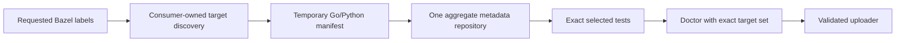

<!--
Unless explicitly stated otherwise all files in this repository are licensed under
the Apache 2.0 License.

This product includes software developed at Datadog
(https://www.datadoghq.com/) Copyright 2025-Present Datadog, Inc.
-->

# Datadog Test Optimization Bazel Module Extension

This repository provides Bazel integrations that fetch Datadog Test Optimization metadata during module/repository resolution and materialize JSON files for use in your build. It also generates public filegroups so consumers can depend on stable labels instead of wiring files manually.

> `v1.4.0` is in preparation; `v1.3.0` remains the latest published release. For releases with an `INSTALL.md` asset, copy its checksum-pinned `archive_override` (Bzlmod) or `http_archive` (WORKSPACE) blocks. Keep core and companions on the same archive. `v1.3.0` predates those assets; its commit-based installation remains supported. See [release installation](docs/Installation_Reference.md#option-a-install-from-a-release-archive-recommended).

## Onboarding paths

Pick the path that matches your repository:

- **Per-language onboarding guide:** [`docs/Language_Onboarding.md`](docs/Language_Onboarding.md)
- **Bzlmod + core only (any language):** sync + uploader integration without language-specific macros
- **Bzlmod + Go companion:** `dd_topt_go_test` macro with importpath inference
- **Bzlmod + Python companion:** `dd_topt_py_test` macro with analysis-time selection
- **Bzlmod + Java companion:** `dd_topt_java_test` macro with analysis-time selection
- **Bzlmod + NodeJS companion:** `dd_topt_nodejs_test` macro with analysis-time selection
- **Bzlmod + .NET companion:** `dd_topt_dotnet_test` macro with analysis-time selection
- **Bzlmod + Ruby companion:** `dd_topt_ruby_test` macro with analysis-time selection
- **Bzlmod + multi-service monorepo:** one sync extension, per-service labels/exports
- **Managed Go/Python monorepo:** one invocation-scoped aggregate repository,
  with targets and services derived by a consumer-owned command instead of a
  checked-in mapping
- **WORKSPACE mode:** fully supported for v1 when Bzlmod is disabled, including Go, Python, and Java companion helpers
- **Other languages:** use core sync/uploader now, or follow companion patterns for custom `dd_topt_<lang>_test` modules

### Sync contract comparison

| Contract | Service selection | Repository shape | Intended use |
|---|---|---|---|
| `test_optimization_sync` | One checked-in service | One repository | Small or single-service workspaces |
| `test_optimization_multi_sync` | Checked-in service list | One repository per service plus an aggregator | Stable static multi-service wiring |
| `test_optimization_manifest_sync` | Invocation-scoped, fully expanded Go/Python targets | One aggregate repository with per-context and per-module labels | Consumer-owned managed commands that derive services automatically |

The manifest-driven API is additive. Existing single-service and static
multi-service consumers do not need to migrate.

Large consumers may also keep explicit single-service repositories and expose
stable ordinary/optimized target pairs such as `//pkg:test` and
`//pkg:test.topt`. In that model the `.topt` target carries a small literal
descriptor for exactly one service repository; Bazel resolves only the
repositories reached by selected `.topt` targets. The manifest-driven model
remains available for consumers that prefer invocation-scoped discovery.

### Ordinary and managed execution

An ordinary test command omits `--config=test-optimization`. Config-gated Go
and Python wrappers preserve the repository's normal test behavior, the
manifest repository emits stable disabled stubs, and no Datadog metadata is
requested.

A managed command owns two Bazel phases behind one user-facing entrypoint:

1. query and fully expand the requested Go/Python test labels;
2. derive service and runtime contexts from those labels and write a private,
   temporary manifest;
3. run metadata sync and the exact selected tests with
   `--config=test-optimization`;
4. run the workspace doctor against the generated exact-target list, then run
   one validated uploader pass: dry-run without upload, or real upload.

The command reuses one manifest path and one resolved metadata snapshot for
test, doctor, and uploader. A later command invocation creates a new
manifest path and fetches current backend state once. When the selected
settings and module payloads are unchanged, those stable test inputs remain
byte-identical and normal Bazel test-result cache hits are preserved.
`telemetry_facts.json` may contain different request timings between
invocations, but it is post-test context and is not a test action input.

Adding or removing a target from the managed invocation changes the temporary
manifest; it does not require a committed target-to-service registry or
per-service repository declaration. The rules in this repository consume that
manifest, but target discovery and service-name policy remain owned by the
consumer command.



See [Installation Reference](docs/Installation_Reference.md#manifest-driven-managed-gopython-monorepos),
[Configuration Reference](docs/Configuration_Reference.md#manifest-sync-extension-attributes),
[Language Onboarding](docs/Language_Onboarding.md#automatic-managed-gopython-monorepos),
and [Troubleshooting](docs/Troubleshooting.md#manifest-driven-managed-runs)
for the detailed contract.

## Documentation map

Use this map to pick the right document instead of guessing from filenames.
Repository behavior is source-of-truth in this repo's code/tests; external docs
are informative and may lag temporarily.

- [`README.md`](README.md): fast onboarding, first-run checklist, and scenario
  quickstarts.
- [`docs/Language_Onboarding.md`](docs/Language_Onboarding.md):
  language-by-language recipes, including Go and large WORKSPACE monorepos.
- [`docs/Installation_Reference.md`](docs/Installation_Reference.md): complete
  installation reference for Bzlmod, WORKSPACE, bootstrap flags, archive pins,
  and generated Bazel config.
- [`docs/Configuration_Reference.md`](docs/Configuration_Reference.md):
  authoritative attributes, flags, and environment variable tables.
- [`docs/Uploader_Reference.md`](docs/Uploader_Reference.md): doctor, dry-run
  enrichment, uploader behavior, credentials, endpoints, and upload modes.
- [`docs/Troubleshooting.md`](docs/Troubleshooting.md): operational debugging
  for sync, payload discovery, doctor failures, enrichment, Git/Bazel metadata,
  and Go tests instrumented by `ddtest instrument`.
- [`docs/Initial_documentation.md`](docs/Initial_documentation.md): current
  architecture overview and data-flow diagrams.
- [`docs/RFC.md`](docs/RFC.md): historical design rationale and trade-offs.
- [`docs/Maintainers.md`](docs/Maintainers.md): maintainer workflows,
  companion-module patterns, CI policy, and release notes.
- [`CONTRIBUTING.md`](CONTRIBUTING.md): contributor validation matrix, CI lanes,
  PR checklist, and release runbook.
- [`examples/README.md`](examples/README.md): copy/paste snippets tied to the
  buildable example workspaces.
- [`tools/agent-skills/go-test-optimization-onboarding/SKILL.md`](tools/agent-skills/go-test-optimization-onboarding/SKILL.md):
  neutral Codex-compatible agent workflow for instrumenting Go WORKSPACE and
  Bzlmod consumers with Test Optimization.
- [`tools/agent-skills/python-test-optimization-onboarding/SKILL.md`](tools/agent-skills/python-test-optimization-onboarding/SKILL.md):
  neutral Codex-compatible agent workflow for instrumenting Python WORKSPACE
  and Bzlmod consumers with Test Optimization.
- [`tools/agent-skills/java-test-optimization-onboarding/SKILL.md`](tools/agent-skills/java-test-optimization-onboarding/SKILL.md):
  neutral Codex-compatible agent workflow for instrumenting Java WORKSPACE and
  Bzlmod consumers with Test Optimization.
- [`docs/internal_monorepo_go_rollout_guide.md`](docs/internal_monorepo_go_rollout_guide.md):
  operator checklist for large WORKSPACE Go pilot rollouts.
- [`SECURITY.md`](SECURITY.md): vulnerability reporting and disclosure policy.
- [`CHANGELOG.md`](CHANGELOG.md): release notes and unreleased changes.

## First-run checklist (all scenarios)

Use this checklist before your first CI rollout:

For config-gated Go and Python onboarding, the named `test-optimization`
config must include
`common:test-optimization --repo_env=DD_TEST_OPTIMIZATION_ENABLED=1`. The
public Go bootstrap helpers apply metadata gating by default. Manual Go
extension wiring uses the same config-gated default. Direct use of the
low-level core sync API in a config-gated Go or Python setup must opt into
`enabled_by_env = True`. Instrumented Go tests select the Go SDK that
`ddtest instrument` instruments through their own transition; no global build
setting is required.
Removing `--config=test-optimization` provides the complete metadata and
runtime opt-out for the Go and Python integrations described below. This
release does not change the enablement contract of the other companions.

When the selected Go sync export is disabled, `dd_topt_go_test` validates its
macro-only inputs and selected service, then calls the supplied `go_test_rule`
directly under the public target name with the caller's original Go rule
arguments. It does not create the hidden raw test, payload selector, Bazel
metadata, registration, or public wrapper targets. This lets a consumer keep
one central `dd_go_test` entry point while the named config decides whether the
same BUILD call is a raw `go_test` or the existing enabled Test Optimization
shape.

When a config-gated Python sync is disabled, `dd_topt_py_test` keeps the
consumer's normal runner and test arguments, omits Test Optimization metadata
and payload wiring, and applies the CI Visibility runtime kill switch
automatically. No per-target disable attribute is required.

1. Keep the generated repo name as `test_optimization_data` (or consistently replace it in labels/commands if you choose another name).
2. Forward sync metadata environment variable names in `.bazelrc` under a named
   config, then use that config for test, doctor, and upload commands:
   - `common:test-optimization --repo_env=DD_API_KEY`
   - `common:test-optimization --repo_env=DD_SITE`
   - `common:test-optimization --repo_env=DD_GIT_REPOSITORY_URL`
   - `common:test-optimization --repo_env=DD_GIT_BRANCH`
   - `common:test-optimization --repo_env=DD_GIT_TAG`
   - `common:test-optimization --repo_env=DD_GIT_COMMIT_SHA`
   - `common:test-optimization --repo_env=DD_PR_NUMBER`
   - `test:test-optimization --remote_download_minimal`
   - `test:test-optimization --remote_download_regex=.*test[.]outputs.*`
   - `test:test-optimization --zip_undeclared_test_outputs`
   - `DD_GIT_*` must use `--repo_env`, never `--test_env`, so Git metadata
     does not become part of the test action cache key.
   - `DD_TEST_OPTIMIZATION_AGENT_URL` and
     `DD_TEST_OPTIMIZATION_AGENTLESS_URL` are not part of the Go test
     sandbox. The uploader reads upload endpoints at `bazel run` time.
   - `FETCH_SALT` is not part of the normal flow. Use it only for a separate,
     explicit force-refresh sync when you intentionally want fresh backend
     metadata.
3. Create exactly one logical doctor/uploader pair. Small repos may put those
   targets in the root package; large monorepos should prefer a lightweight
   package such as `//tools/test_optimization`.
4. Use the named test config for BwoB, selective `test.outputs`
   materialization, and zipped undeclared outputs. Do not store
   `--build_event_json_file` in `.bazelrc`; CI wrappers should create a fresh
   BEP file path for each Bazel test invocation so parallel jobs cannot
   overwrite each other.
5. Configure doctor and the validated uploader with the matching BEP
   files and BEP artifact staging through wrapper arguments:
   - `--bep-json=<path>` once per Bazel test invocation
   - `--freshness-source=bep`
   - `--freshness-mode=required`
   - `--artifact-source=bep`
   - `--artifact-staging-dir=<per-run-temp-dir>`
   Keep `--remote-artifacts=disabled` unless BEP references remote-only
   artifacts that Bazel did not materialize locally. HTTP/HTTPS `outputs.zip`
   carriers can use native staging; bytestream/CAS/custom-auth providers need a
   downloader.

## Published Go onboarding pins

When a repository consumes this project from GitHub, pin a commit that is
already reachable from `origin/main`. Do not publish snippets that point at a
feature-branch commit: those commits can disappear after squash merge and break
consumer resolution.

Maintainers can generate the WORKSPACE/archive tuple from this checkout:

```bash
./bazelw run //tools/dev:print_go_onboarding_pins -- \
  --commit "$(git rev-parse origin/main)" \
  --verify-main-reachable
```

The helper verifies that the commit is reachable from `origin/main`, downloads
the real GitHub codeload archive, and prints `RTO_COMMIT`, `RTO_REMOTE`,
`RTO_ARCHIVE_URL`, `RTO_ARCHIVE_SHA256`, `RTO_ARCHIVE_PREFIX`, and
`RTO_ARCHIVE_TYPE`. Add `--print-summary` to also print a Markdown summary.
Published GitHub pins use `tar.gz`; other archive types must be mirrored and
documented outside this helper. The archive URL, SHA256, and prefix are tied to
the repository commit.

Consumers using the Go bootstrap can print the same tuple or write a
repository-local summary:

```bash
bazel run @datadog-rules-test-optimization-go//:dd_topt_go_bootstrap -- \
  --print-published-pins \
  --rto-commit <published-origin-main-sha>

bazel run @datadog-rules-test-optimization-go//:dd_topt_go_bootstrap -- \
  --write-onboarding-summary=TEST_OPTIMIZATION_GUIDE.md \
  --rto-commit <published-origin-main-sha>
```

If the bootstrap runs from a checkout that has this repository's Git history,
add `--verify-main-reachable` to enforce the same `origin/main` reachability
check as the dev helper.

## Quickstart by scenario

Replace `<release-archive-url>`, `<release-archive-sha256>`, and
`<archive-prefix>` with the values from the release's `INSTALL.md`. Match the
Datadog `bazel_dep` versions to that release; the snippets below use the `1.4.0`
API. Until `v1.4.0` is published, use an explicit commit override for development
or `v1.3.0` for a published version. For versions without bundle assets, use
the [Git alternative](docs/Installation_Reference.md#option-b-install-from-a-git-commit).

### Bzlmod + core only (any language)

Use this when you do not need `dd_topt_go_test`:

```bzl
# MODULE.bazel
bazel_dep(name = "datadog-rules-test-optimization", version = "1.4.0")
archive_override(
    module_name = "datadog-rules-test-optimization",
    urls = ["<release-archive-url>"],
    sha256 = "<release-archive-sha256>",
    strip_prefix = "<archive-prefix>",
)

test_optimization_sync = use_extension(
    "@datadog-rules-test-optimization//tools/core:test_optimization_sync.bzl",
    "test_optimization_sync_extension",
)
test_optimization_sync.test_optimization_sync(
    name = "test_optimization_data",
    service = "my-service",  # or set DD_SERVICE via --repo_env
)
use_repo(test_optimization_sync, "test_optimization_data")
```

The low-level core API remains always enabled by default. Set
`enabled_by_env = True` only when this repository is part of the config-gated
Go or Python onboarding described below. Other companions retain their current
enablement contract.

```bzl
# BUILD.bazel (workspace root)
load("@datadog-rules-test-optimization//tools/core:test_optimization_targets.bzl", "dd_test_optimization_targets")

dd_test_optimization_targets(
    name = "test_optimization",
)
```

For first-pass troubleshooting after a test run, ask the customer for the
doctor bundle:

```bash
bazel run //:dd_test_optimization_doctor -- \
  --support-bundle .topt/reports/dd-test-optimization-support.zip
```

When diagnosing BEP/BwoB CI behavior, pass the same `--bep-json`,
`--freshness-*`, and `--artifact-*` flags you would pass to the doctor manually.
The doctor bundle is doctor-only; it does not prove uploader dry-run,
enrichment, or upload behavior.
For the full escalation ladder and the order to inspect files inside the zip,
see [Collect diagnostic reports](docs/Troubleshooting.md#collect-diagnostic-reports).

```bash
# Copy or vendor the full tools/test_optimization/ helper directory into the
# consumer repo. The support bundle option needs create_support_bundle.py beside
# the wrapper, or DD_TEST_OPTIMIZATION_SUPPORT_BUNDLE_COLLECTOR pointing to it.
tools/test_optimization/run_test_optimization_ci.sh \
  --report-dir .topt/reports \
  --support-bundle .topt/reports/dd-test-optimization-support.zip \
  //...

# Add --upload to send every available fresh valid payload after validation attempts.
DD_API_KEY="$DD_API_KEY" DD_SITE="$DD_SITE" \
  tools/test_optimization/run_test_optimization_ci.sh \
    --report-dir .topt/reports \
    --support-bundle .topt/reports/dd-test-optimization-support.zip \
    --upload \
    //...
```

```powershell
# Copy or vendor the full tools/test_optimization/ helper directory into the
# consumer repo. The support bundle option needs create_support_bundle.py beside
# the wrapper, or DD_TEST_OPTIMIZATION_SUPPORT_BUNDLE_COLLECTOR pointing to it.
.\tools\test_optimization\run_test_optimization_ci.ps1 `
  -ReportDir .topt\reports `
  -SupportBundle .topt\reports\dd-test-optimization-support.zip `
  //...

# Add -Upload to send every available fresh valid payload after validation attempts.
$env:DD_API_KEY = "<your-api-key>"
$env:DD_SITE = "datadoghq.com"
.\tools\test_optimization\run_test_optimization_ci.ps1 `
  -ReportDir .topt\reports `
  -SupportBundle .topt\reports\dd-test-optimization-support.zip `
  -Upload `
  //...
```

### Bzlmod + Go companion (`dd_topt_go_test`)

`dd_topt_go_test` builds each enabled test with the Go SDK that
[`ddtest instrument`](https://github.com/DataDog/ddtest/blob/main/ddto/docs/bazel.md)
instruments, and links Mini, ddtest's Test Optimization runtime. `rules_go` is
the upstream module from the Bazel Central Registry, `0.60.0` or newer. The Go
module needs no Datadog requirement in `go.mod`, and the instrumentation needs
no Go installation on the host.

For a fresh single-service Go workspace, start with the small manual
prerequisite block below, then let the guided bootstrap finish the Go-specific
setup.

```bzl
bazel_dep(name = "datadog-rules-test-optimization", version = "1.4.0")
archive_override(
    module_name = "datadog-rules-test-optimization",
    urls = ["<release-archive-url>"],
    sha256 = "<release-archive-sha256>",
    strip_prefix = "<archive-prefix>",
)

bazel_dep(name = "datadog-rules-test-optimization-go", version = "1.4.0")
archive_override(
    module_name = "datadog-rules-test-optimization-go",
    urls = ["<release-archive-url>"],
    sha256 = "<release-archive-sha256>",
    strip_prefix = "<archive-prefix>/modules/go",
)
bazel_dep(name = "rules_go", version = "0.60.0")
```

Then run the Datadog bootstrap helper once from the workspace that owns your
Go module. `--runtime-version` is the Go version of the SDK that
`ddtest instrument` instruments, and the runtime version of the sync metadata.

```bash
bazel run @datadog-rules-test-optimization-go//:dd_topt_go_bootstrap -- \
  --guided \
  --service go-service \
  --runtime-version 1.25.0 \
  --write-bazelrc
```

If the Go module lives below the workspace root:

```bash
bazel run @datadog-rules-test-optimization-go//:dd_topt_go_bootstrap -- \
  --guided \
  --service go-service \
  --runtime-version 1.25.0 \
  --go-module-dir path/to/go-module \
  --write-bazelrc
```

The bootstrap helper:
- adds a Datadog-managed block to `MODULE.bazel` that configures the
  instrumented Go SDK with `topt_go_ddtest.sdk(go_version = "<runtime-version>")`
- adds `bazel_dep(name = "rules_go", version = "0.60.0")` when `MODULE.bazel`
  has no `rules_go` dependency
- adds the Datadog-managed single-service Go sync block (`test_optimization_go_extension`)
- creates a root `dd_test_optimization_doctor` target when missing
- creates a root `dd_upload_payloads` target when missing
- can print or write the recommended `.bazelrc` block with
  `--print-bazelrc-snippet` or `--write-bazelrc`
- creates one central `//tools/build:dd_go_test.bzl` entry point for
  workspace-local Go tests, which delegates every call to `dd_topt_go_test`;
  omitting the named config makes the generated disabled export preserve normal
  `go_test` behavior under the same public target name

The managed block looks like this:

```bzl
# BEGIN Datadog Go Test Optimization bootstrap
topt_go_ddtest = use_extension(
    "@datadog-rules-test-optimization-go//:topt_go_ddtest_extension.bzl",
    "topt_go_ddtest",
)
topt_go_ddtest.sdk(go_version = "1.25.0")
# END Datadog Go Test Optimization bootstrap
```

Without `--guided`, the bootstrap writes only this block and the `rules_go`
dependency when it is missing. Without `--runtime-version`, the block reads
`topt_go_ddtest.sdk(go_mod = "//:go.mod")` (or the `go.mod` label of the
`--go-module-dir` package), and the extension takes the Go version from the
`toolchain` directive, then the `go` directive. That package needs a `BUILD`
file; the bootstrap stops otherwise. Workspaces that do not use the bootstrap
add the same two lines by hand. The Go companion registers the toolchains, so
the root module registers none. See
[Go instrumentation SDK](docs/Configuration_Reference.md#go-instrumentation-sdk)
for the `sdk` tag attributes.

Only instrumented tests select these toolchains, so other builds fetch neither
the instrumented SDKs nor Mini, and Bazel fetches only the SDKs of the exec
platforms it selects. Without an `sdk` tag, an instrumented test fails with a
message that says what to configure; see
[Troubleshooting](docs/Troubleshooting.md#instrumented-test-fails-no-go-sdk-to-instrument).

Rerunning the bootstrap on a workspace set up by 1.x replaces the Go block that
1.x wrote. See the [migration note](CHANGELOG.md#unreleased) and
[Bootstrap stops on a rules_go fork override](docs/Troubleshooting.md#bootstrap-stops-on-a-rules_go-fork-override).

If the Go module requires `github.com/DataDog/ddtest/ddto` to use Mini's Go API
in tests, replace `go_deps`' copy with the generated Mini, or the test fails at
analysis:

```bzl
use_repo(topt_go_ddtest, "topt_go_ddtest_mini")
override_repo(go_deps, com_github_datadog_ddtest_ddto = "topt_go_ddtest_mini")
```

By default, `dd_topt_go_test` also sets `DD_SERVICE` from the selected sync
metadata service name. If you already set `DD_SERVICE` in the test target's
`env`, the macro preserves your explicit value. If you pass `env = select(...)`,
the macro leaves that configurable env unchanged in this release.

The generated `.bazelrc` block is managed between
`# BEGIN Datadog Test Optimization Bazelrc` and
`# END Datadog Test Optimization Bazelrc`. It forwards sync metadata through
`common:test-optimization --repo_env=...` and adds
`test:test-optimization --remote_download_minimal` plus
`test:test-optimization --remote_download_regex=.*test[.]outputs.*` and
`test:test-optimization --zip_undeclared_test_outputs`. It deliberately does
not generate a fixed `--build_event_json_file`; wrappers should pass a fresh
BEP path for each Bazel test invocation. It deliberately does not generate
`--test_env=DD_GIT_*`,
`--test_env=DD_TEST_OPTIMIZATION_AGENT_URL`, or
`--test_env=DD_TEST_OPTIMIZATION_AGENTLESS_URL`.

Then use the generated local wrapper in your package:

```bzl
load("//tools/build:dd_go_test.bzl", "dd_go_test")

dd_go_test(
    name = "pkg_go_test",
    srcs = ["pkg_test.go"],
    embed = [":pkg_lib"],
)
```

Use the manual `dd_topt_go_test(..., topt_data = ...)` path only when the
workspace already has custom sync wiring, mixed-language layout, or multi-service
Go setup.

For an enabled export, `dd_topt_go_test` creates a hidden raw `go_test` built
with the instrumented Go SDK, adds Mini's `testopt` library and a registration
file to it, and exposes it through the public test target. It also adds the
test-binary linker flags `-s -w` where `rules_go` does not already strip and the
build does not ask for debug or unstripped binaries; set
`enable_test_binary_linker_optimization = False` to keep the caller's linker
flags unchanged. See
[`dd_topt_go_test` attributes](docs/Configuration_Reference.md#dd_topt_go_test-attributes).

An explicit per-service integration can pass the same macro a local-static
descriptor instead of loading an external repository's `export.bzl`:

```bzl
dd_topt_go_test(
    name = "pkg_go_test.topt",
    topt_data = {
        "repo_name": "test_optimization_data_go_service",
        "service_name": "go-service",
        "runtime_module_path": "example.com/repo",
    },
    srcs = ["pkg_test.go"],
)
```

The selected repository must expose the stable state and payload labels
generated by `test_optimization_sync`. Its state target carries the generated
module catalog, so the macro applies the same `importpath` lookup used with a
loaded `export.bzl` and gives each test only its matching package payloads. The
descriptor's `runtime_module_path` identifies the synchronized Go repository;
it does not force every test to use the repository-root bundle. Disabled or
mismatched repositories fail analysis. This descriptor is an additive option;
generated single-, multi-, and manifest-sync exports keep their existing
behavior.

The `.topt` clone preserves the source test's execution policy. A source tagged
`no-remote-exec` therefore still runs its `TestRunner` locally, but that policy
does not leak into deterministic build actions such as standard library
preparation, compilation, or linking. Those actions remain eligible for normal
Bazel caching and remote execution.

Large consumers can warm the matching instrumented standard library in a
dedicated cache-writing invocation:

```bzl
load("@datadog-rules-test-optimization-go//:topt_go_stdlib.bzl", "dd_topt_go_stdlib_warmup")

dd_topt_go_stdlib_warmup(name = "go_stdlib_warmup")
```

```bash
bazel build //tools/test_optimization:go_stdlib_warmup \
  --config=test-optimization \
  --config=remote-cache-write
```

The warmup target applies the same Go configuration transitions as an
instrumented test and materializes the standard library built with the
instrumented Go SDK, plus its build cache directory. Ordinary Go actions
neither publish nor consume that instrumented cache. The consumer remains
responsible for restricting remote-cache writes to a trusted CI invocation.
The target is tagged `manual`, so wildcard builds skip it. Building it needs the
instrumented SDK configured, with or without the named config.

### Bzlmod + Python companion (`dd_topt_py_test`)

Configure the Python sync extension with `enabled_by_env = True` and put
`common:test-optimization --repo_env=DD_TEST_OPTIMIZATION_ENABLED=1` in the
named config. Python does not declare `rules_go` and needs no Go SDK
configuration.

```bzl
bazel_dep(name = "datadog-rules-test-optimization", version = "1.4.0")
archive_override(
    module_name = "datadog-rules-test-optimization",
    urls = ["<release-archive-url>"],
    sha256 = "<release-archive-sha256>",
    strip_prefix = "<archive-prefix>",
)

bazel_dep(name = "datadog-rules-test-optimization-python", version = "1.4.0")
archive_override(
    module_name = "datadog-rules-test-optimization-python",
    urls = ["<release-archive-url>"],
    sha256 = "<release-archive-sha256>",
    strip_prefix = "<archive-prefix>/modules/python",
)

python_topt = use_extension(
    "@datadog-rules-test-optimization//tools/core:test_optimization_sync.bzl",
    "test_optimization_sync_extension",
)
python_topt.test_optimization_sync(
    name = "test_optimization_data",
    enabled_by_env = True,
    runtime_module_path = "<python-module-path>",
    runtime_name = "python",
    runtime_version = "3.12",
    service = "python-service",
)
use_repo(python_topt, "test_optimization_data")
```

```bzl
load("@python_deps//:requirements.bzl", "requirement")
load("@datadog-rules-test-optimization-python//:topt_py_test.bzl", "dd_topt_py_test")
load("@test_optimization_data//:export.bzl", "topt_data")

dd_topt_py_test(
    name = "pkg_py_test",
    srcs = glob(["test_*.py"]),
    deps = [
        ":pkg_lib",
        requirement("ddtrace"),
        requirement("pytest"),
    ],
    imports = ["example/python/pkg"],
    topt_data = topt_data,
)
```

`dd_topt_py_test` now defaults to `@rules_python//python:py_test`, so you only
need `py_test_rule` when you intentionally override the underlying test rule.
When you omit `main`, the macro uses the bundled pytest entry point, defaults
`args` to the Bazel package path, and adds `PYTEST_ADDOPTS=--ddtrace` unless
you already set it or opt out with `--no-ddtrace`. This default mode is
`runner_mode = "managed_pytest"` and is the right choice when the repository
does not already own a pytest runner.

Large repositories with their own Python wrapper can use
`runner_mode = "consumer_runner"` to keep control of `main`, `imports`, and
test execution policy:

```bzl
dd_topt_py_test(
    name = "pkg_py_test",
    py_test_rule = my_repo_pytest_wrapper,
    runner_mode = "consumer_runner",
    srcs = glob(["test_*.py"]),
    deps = [
        ":pkg_lib",
        requirement("ddtrace"),
        requirement("pytest"),
    ],
    topt_data = topt_data,
)
```

In `consumer_runner` mode, pass a repository-owned `py_test_rule` wrapper or an
explicit `main` that executes pytest with the ddtrace plugin enabled. The base
`rules_python` `py_test` without `main` is rejected because it does not prove
pytest is actually running. When the runtime module path and Bazel package path
identify the test, omit `module_identifier` and use the derived fallback. Pass
an explicit `module_identifier` only for a documented repository-specific
exception. When synchronized metadata exposes module groups, an explicit
identifier that does not match one fails analysis. If no module groups exist,
or an inferred or derived identifier misses, the selector uses the canonical
full bundle. The macro does not need to synthesize Python `imports` for the
normal path.
Replace `@python_deps` with the repository name generated by your
`rules_python` `pip_parse` / `pip.parse` setup.

For Python monorepos, keep the doctor and uploader in a lightweight package
instead of forcing the workspace root package to analyze. The convenience macro
creates both targets with consistent context wiring:

```bzl
# tools/test_optimization/BUILD.bazel
load("@datadog-rules-test-optimization//tools/core:test_optimization_targets.bzl", "dd_test_optimization_targets")

dd_test_optimization_targets(
    name = "test_optimization",
    sync_repo_name = "test_optimization_data",
    doctor_name = "dd_test_optimization_doctor",
    uploader_name = "dd_upload_payloads",
    expected_targets = [
        "//python/app:pkg_py_test",
    ],
)
```

Then run `//tools/test_optimization:dd_test_optimization_doctor` and
`//tools/test_optimization:dd_upload_payloads`. Root labels remain valid for
small repositories; package-local labels are the safer default for large
monorepos because they avoid accidental analysis of unrelated root wiring.

The Python companion also publishes a read-only snippet generator:

```bash
bazel run @datadog-rules-test-optimization-python//tools/dd_topt_py_bootstrap:dd_topt_py_bootstrap -- \
  --mode=workspace \
  --service my-python-service \
  --runtime-version 3.12 \
  --runtime-module-path example.python.pkg \
  --rto-commit <commit-sha> \
  --private-repo-fetch ssh-git \
  --bazel-command bzl
```

By default it prints the normal onboarding snippets only. It never adds
`FETCH_SALT` to `.bazelrc`, test, doctor, or uploader commands. To force a
metadata refresh deliberately, ask for the separate refresh snippet:

```bash
bazel run @datadog-rules-test-optimization-python//tools/dd_topt_py_bootstrap:dd_topt_py_bootstrap -- \
  --mode=workspace \
  --service my-python-service \
  --runtime-version 3.12 \
  --runtime-module-path example.python.pkg \
  --rto-commit <commit-sha> \
  --print-refresh-snippet
```

For internal/private repositories, prefer SSH git fetch
(`ssh://git@github.com/DataDog/rules_test_optimization.git`) unless your Bazel
environment has authenticated archive access. A `404` from an unauthenticated
codeload URL usually means authentication is missing, not that the commit is
absent.

### Bzlmod + Java companion (`dd_topt_java_test`)

```bzl
bazel_dep(name = "datadog-rules-test-optimization-java", version = "1.4.0")
archive_override(
    module_name = "datadog-rules-test-optimization-java",
    urls = ["<release-archive-url>"],
    sha256 = "<release-archive-sha256>",
    strip_prefix = "<archive-prefix>/modules/java",
)
```

```bzl
load("@datadog-rules-test-optimization-java//:topt_java_test.bzl", "dd_topt_java_test")
load("@test_optimization_data//:export.bzl", "topt_data")

dd_topt_java_test(
    name = "pkg_java_test",
    srcs = ["*Test.java"],
    deps = [":pkg_lib"],
    test_class = "com.example.pkg.SampleTest",
    topt_data = topt_data,
    agent_jar = "@dd_java_agent//file",
)
```

`dd_topt_java_test` defaults to `@rules_java//java:defs.bzl%java_test`, so most
callers do not need to pass `java_test_rule`. Override it only when wrapping a
custom test macro (e.g. a junit5 wrapper). The macro requires `agent_jar` so
the dd-java-agent is wired into `-javaagent` and emits payloads; source the
JAR with `http_file`/`maven_install`/a local filegroup.
The macro injects the Java agent to take care of tracer instrumentation, so
callers do not need to add their own `-javaagent` flag.

On Windows, add `build --enable_runfiles` to your `.bazelrc`. The macro injects
`-javaagent:$(rootpath <agent_jar>)`, which only resolves when runfiles are
materialized as symlinks; Linux and macOS already do this by default.

CI Visibility is on by
default — set `ci_visibility_enabled = False` only if your callsite owns
`DD_CIVISIBILITY_ENABLED`.

If you want the tracer to populate `test.source.file`, `test.source.start`, and
`test.source.end` tags, opt into source staging:

```bzl
dd_topt_java_test(
    name = "pkg_java_test",
    srcs = ["SampleTest.java"],
    stage_sources = True,
    test_class = "com.example.pkg.SampleTest",
    topt_data = topt_data,
    agent_jar = "@dd_java_agent//file",
)
```

`stage_sources` adds the target's direct `srcs` to runfiles so the tracer's
repo index can resolve them. Defaults to false because Bazel test runfiles do
not include `srcs` by default and the extra files cost runfiles size.

### Bzlmod + NodeJS companion (`dd_topt_nodejs_test`)

```bzl
bazel_dep(name = "aspect_rules_js", version = "3.0.0-rc5")
bazel_dep(name = "rules_nodejs", version = "6.7.3")
bazel_dep(name = "datadog-rules-test-optimization-nodejs", version = "1.4.0")
archive_override(
    module_name = "datadog-rules-test-optimization-nodejs",
    urls = ["<release-archive-url>"],
    sha256 = "<release-archive-sha256>",
    strip_prefix = "<archive-prefix>/modules/nodejs",
)

node = use_extension("@rules_nodejs//nodejs:extensions.bzl", "node")
node.toolchain(node_version = "22.22.0")
use_repo(node, "nodejs", "nodejs_host", "nodejs_toolchains")
register_toolchains("@nodejs_toolchains//:all")
```

```bzl
load("@aspect_rules_js//js:defs.bzl", "js_test")
load("@datadog-rules-test-optimization-nodejs//:topt_nodejs_test.bzl", "dd_topt_nodejs_test")
load("@test_optimization_data//:export.bzl", "topt_data")

dd_topt_nodejs_test(
    name = "pkg_nodejs_test",
    entry_point = "smoke_test.js",
    copy_data_to_bin = False,  # Datadog payload data comes from external repos.
    module_identifier = "apps/nodejs/pkg",
    topt_data = topt_data,
    nodejs_test_rule = js_test,
)
```

### Bzlmod + .NET companion (`dd_topt_dotnet_test`)

```bzl
bazel_dep(name = "rules_dotnet", version = "0.21.5")
bazel_dep(name = "datadog-rules-test-optimization-dotnet", version = "1.4.0")
archive_override(
    module_name = "datadog-rules-test-optimization-dotnet",
    urls = ["<release-archive-url>"],
    sha256 = "<release-archive-sha256>",
    strip_prefix = "<archive-prefix>/modules/dotnet",
)

dotnet = use_extension("@rules_dotnet//dotnet:extensions.bzl", "dotnet")
dotnet.toolchain(
    name = "dotnet",
    dotnet_version = "8.0.100",
)
use_repo(dotnet, "dotnet_toolchains")
register_toolchains("@dotnet_toolchains//:all")
```

```bzl
load("@datadog-rules-test-optimization-dotnet//:topt_dotnet_test.bzl", "dd_topt_dotnet_test")
load("@test_optimization_data//:export.bzl", "topt_data")
load(":dotnet_test_adapter.bzl", "dotnet_csharp_test_adapter")

dd_topt_dotnet_test(
    name = "pkg_dotnet_test",
    srcs = ["smoke_test.cs"],
    target_frameworks = ["net8.0"],
    module_identifier = "Company.Product.Package",
    topt_data = topt_data,
    dotnet_test_rule = dotnet_csharp_test_adapter,
)
```

`dotnet_test_adapter.bzl` wraps `@rules_dotnet//dotnet:defs.bzl` `csharp_test` and maps the Datadog macro's `env` to `csharp_test(envs = ...)`.

```bzl
# dotnet_test_adapter.bzl
load("@rules_dotnet//dotnet:defs.bzl", "csharp_test")

def dotnet_csharp_test_adapter(name, data = None, env = None, **kwargs):
    envs = dict(kwargs.pop("envs", {}))
    if env:
        envs.update(env)

    csharp_test(
        name = name,
        data = [] if data == None else data,
        envs = envs,
        **kwargs
    )
```

### Bzlmod + Ruby companion (`dd_topt_ruby_test`)

```bzl
bazel_dep(name = "rules_ruby", version = "0.21.1")
bazel_dep(name = "datadog-rules-test-optimization-ruby", version = "1.4.0")
archive_override(
    module_name = "datadog-rules-test-optimization-ruby",
    urls = ["<release-archive-url>"],
    sha256 = "<release-archive-sha256>",
    strip_prefix = "<archive-prefix>/modules/ruby",
)

ruby = use_extension("@rules_ruby//ruby:extensions.bzl", "ruby")
ruby.toolchain(
    name = "ruby",
    version = "3.3.9",
)
use_repo(ruby, "ruby", "ruby_toolchains")
register_toolchains("@ruby_toolchains//:all")
```

```bzl
load("@rules_ruby//ruby:defs.bzl", "rb_test")
load("@datadog-rules-test-optimization-ruby//:topt_ruby_test.bzl", "dd_topt_ruby_test")
load("@test_optimization_data//:export.bzl", "topt_data")

dd_topt_ruby_test(
    name = "pkg_ruby_test",
    srcs = ["smoke_test.rb"],
    main = "smoke_test.rb",
    module_identifier = "apps/ruby/pkg",
    topt_data = topt_data,
    ruby_test_rule = rb_test,
)
```

### Optional: workspace-local wrappers (less boilerplate)

If your workspace always uses the same synced repo (`@test_optimization_data`)
and the same underlying test rule symbols, create thin local wrappers so
package BUILD files do not repeat `topt_data` and `*_test_rule`.

For config-gated Go onboarding, keep one central wrapper. It always delegates
to `dd_topt_go_test`; the named config selects enabled metadata and the
instrumented test, while the stable disabled export preserves normal `go_test`
behavior without metadata requests. Python can use the same central-wrapper
shape when its sync repository sets `enabled_by_env = True`. Other companions
retain their existing enablement contract in this release.

Single-service wrapper pattern for a simple Go workspace:

```bzl
# tools/build/dd_go_test.bzl
load("@datadog-rules-test-optimization-go//:topt_go_test.bzl", "dd_topt_go_test")
load("@test_optimization_data//:export.bzl", "topt_data")

def dd_go_test(name, **kwargs):
    dd_topt_go_test(
        name = name,
        topt_data = topt_data,
        **kwargs
    )
```

```bzl
# package BUILD.bazel
load("//tools/build:dd_go_test.bzl", "dd_go_test")

dd_go_test(
    name = "pkg_go_test",
    srcs = ["pkg_test.go"],
    embed = [":pkg_lib"],
)
```

You can apply the same pattern to all companion macros:

```bzl
# tools/build/dd_py_test.bzl
load("@datadog-rules-test-optimization-python//:topt_py_test.bzl", "dd_topt_py_test")
load("@test_optimization_data//:export.bzl", "topt_data")

def dd_py_test(name, **kwargs):
    dd_topt_py_test(
        name = name,
        topt_data = topt_data,
        **kwargs
    )
```

```bzl
# tools/build/dd_java_test.bzl
load("@datadog-rules-test-optimization-java//:topt_java_test.bzl", "dd_topt_java_test")
load("@test_optimization_data//:export.bzl", "topt_data")

def dd_java_test(name, **kwargs):
    dd_topt_java_test(
        name = name,
        topt_data = topt_data,
        agent_jar = "@dd_java_agent//file",
        **kwargs
    )
```

```bzl
# tools/build/dd_nodejs_test.bzl
load("@aspect_rules_js//js:defs.bzl", "js_test")
load("@datadog-rules-test-optimization-nodejs//:topt_nodejs_test.bzl", "dd_topt_nodejs_test")
load("@test_optimization_data//:export.bzl", "topt_data")

def dd_nodejs_test(name, **kwargs):
    dd_topt_nodejs_test(
        name = name,
        topt_data = topt_data,
        nodejs_test_rule = js_test,
        **kwargs
    )
```

```bzl
# tools/build/dd_dotnet_test.bzl
load("@datadog-rules-test-optimization-dotnet//:topt_dotnet_test.bzl", "dd_topt_dotnet_test")
load("@test_optimization_data//:export.bzl", "topt_data")
load("//:dotnet_test_adapter.bzl", "dotnet_csharp_test_adapter")

def dd_dotnet_test(name, **kwargs):
    dd_topt_dotnet_test(
        name = name,
        topt_data = topt_data,
        dotnet_test_rule = dotnet_csharp_test_adapter,
        **kwargs
    )
```

```bzl
# tools/build/dd_ruby_test.bzl
load("@rules_ruby//ruby:defs.bzl", "rb_test")
load("@datadog-rules-test-optimization-ruby//:topt_ruby_test.bzl", "dd_topt_ruby_test")
load("@test_optimization_data//:export.bzl", "topt_data")

def dd_ruby_test(name, **kwargs):
    dd_topt_ruby_test(
        name = name,
        topt_data = topt_data,
        ruby_test_rule = rb_test,
        **kwargs
    )
```

For multi-service repos, either:

1. Keep `topt_service` as a wrapper argument and pass `topt_data_by_service`
2. Create one wrapper per service with `topt_service` pre-set

### Bzlmod + multi-service monorepo

Use the Go extension multi-service form only for multi-service Go setups. It is
not a generic mixed-runtime extension; every service configured through it is
materialized as `runtime_name = "go"`. For Python/Java/NodeJS/.NET/Ruby
multi-service onboarding, use
[`docs/Language_Onboarding.md`](docs/Language_Onboarding.md).

```bzl
go_topt = use_extension(
    "@datadog-rules-test-optimization-go//:topt_go_extension.bzl",
    "test_optimization_go_extension",
)

go_topt.test_optimization_go(
    name = "test_optimization_data",
    services = ["go-service-a", "go-service-b"],
    runtime_version = "1.25.0",
)

use_repo(
    go_topt,
    "test_optimization_data",
    "test_optimization_data_go_service_a",
    "test_optimization_data_go_service_b",
)
```

For macro consumers, load `topt_data_by_service` from
`@test_optimization_data//:export.bzl` and select by `topt_service`.

### Bzlmod + mixed-language monorepo

For mixed-runtime repos, keep one sync repo per runtime or runtime/service
slice and use the matching companion on top of each exported dataset. Do not
reuse one shared sync repo across different runtimes.

```bzl
topt_go = use_extension(
    "@datadog-rules-test-optimization//tools/core:test_optimization_sync.bzl",
    "test_optimization_sync_extension",
)
topt_go.test_optimization_sync(
    name = "test_optimization_data_go",
    service = "go-service",
    runtime_name = "go",
    runtime_version = "1.25.0",
    enabled_by_env = True,
)

topt_ruby = use_extension(
    "@datadog-rules-test-optimization//tools/core:test_optimization_sync.bzl",
    "test_optimization_sync_extension",
)
topt_ruby.test_optimization_sync(
    name = "test_optimization_data_ruby",
    service = "ruby-service",
    runtime_name = "ruby",
    runtime_version = "3.3.9",
)

use_repo(topt_go, "test_optimization_data_go")
use_repo(topt_ruby, "test_optimization_data_ruby")
```

Then load the matching export in each runtime-specific wrapper or BUILD file:
- Go targets use `@test_optimization_data_go//:export.bzl`
- Ruby targets use `@test_optimization_data_ruby//:export.bzl`

Workspace doctor/uploader wiring in a mixed-runtime setup must bundle every
matching context target so validation and upload enrichment use the correct
`context.json` per payload:

```bzl
load("@datadog-rules-test-optimization//tools/core:test_optimization_targets.bzl", "dd_test_optimization_targets")

dd_test_optimization_targets(
    name = "test_optimization",
    context_data = [
        "@test_optimization_data_go//:test_optimization_context",
        "@test_optimization_data_ruby//:test_optimization_context",
    ],
)
```

### WORKSPACE mode

WORKSPACE remains supported for v1. Minimal setup:

```bzl
# WORKSPACE
load("@bazel_tools//tools/build_defs/repo:git.bzl", "git_repository")

git_repository(
    name = "datadog-rules-test-optimization",
    remote = "https://github.com/DataDog/rules_test_optimization.git",
    commit = "<commit-sha>",
)

load("@datadog-rules-test-optimization//tools/core:test_optimization_sync.bzl", "test_optimization_sync")

test_optimization_sync(
    name = "test_optimization_data",
    service = "my-service",  # recommended; otherwise falls back to DD_SERVICE or unnamed-service
)
```

This low-level WORKSPACE example preserves the always-enabled core default.
The public Go extension is config-gated by default. Config-gated Python
consumers set `enabled_by_env = True` through their language-specific setup;
the other companions remain unchanged.

For Go in WORKSPACE mode, keep the core and Go companion as separate external
repositories and load `dd_topt_go_test` from
`@datadog-rules-test-optimization-go//:topt_go_test.bzl`. Declare upstream
`rules_go` first, named `io_bazel_rules_go`: the instrumented SDK repositories
load it under that name. Then use the public WORKSPACE helper, which declares
only the Go companion, and declare the instrumented Go SDK after `rules_go`'s
own setup:

```bzl
load("@datadog-rules-test-optimization//tools/go:workspace_repositories.bzl", "datadog_go_test_optimization_workspace_repositories")

datadog_go_test_optimization_workspace_repositories(
    rto_commit = "<commit-sha>",
)

load("@io_bazel_rules_go//go:deps.bzl", "go_register_toolchains", "go_rules_dependencies")

go_rules_dependencies()

go_register_toolchains(version = "1.25.0")

load("@datadog-rules-test-optimization-go//:topt_go_ddtest_repository.bzl", "topt_go_ddtest_workspace_repositories")

topt_go_ddtest_workspace_repositories(go_version = "1.25.0")
```

`topt_go_ddtest_workspace_repositories` takes the same arguments as the Bzlmod
`sdk` tag except `go_mod`, and registers the toolchains. To instrument the SDK
that `go_register_toolchains` declared instead of downloading one, pass
`base_sdk_roots = {"linux_amd64": "@go_sdk//:ROOT"}` together with
`exec_platforms = ["linux_amd64"]`, or keep `go_version` for the other exec
platforms. `datadog_go_test_optimization_workspace_repositories` fails when
`rules_go` is not declared yet. See
[step 8 of the WORKSPACE installation](docs/Installation_Reference.md#8-configure-go-support-in-workspace-with-the-public-helper)
for the complete file.

For Python in WORKSPACE mode, declare `rules_python` and the core repository
first, then use the public Python helper to declare only the Python companion:

```bzl
load("@datadog-rules-test-optimization//tools/python:workspace_repositories.bzl", "datadog_python_test_optimization_workspace_repositories")

datadog_python_test_optimization_workspace_repositories(
    rto_commit = "<commit-sha>",
    rules_python_repo_name = "rules_python",
)
```

The Python helper deliberately does not declare Python toolchains, `pip_parse`,
`pytest`, `ddtrace`, or lockfiles. Keep those dependencies in the consumer
repository's existing `rules_python` setup, then load
`dd_topt_py_test` from
`@datadog-rules-test-optimization-python//:topt_py_test.bzl`.

For Java in WORKSPACE mode, declare `rules_java` and the core repository first,
then use the public Java helper to declare only the Java companion:

```bzl
load("@datadog-rules-test-optimization//tools/java:workspace_repositories.bzl", "datadog_java_test_optimization_workspace_repositories")

datadog_java_test_optimization_workspace_repositories(
    rto_commit = "<commit-sha>",
    rules_java_repo_name = "rules_java",
)
```

The Java helper deliberately does not declare Java toolchains, test framework
dependencies, or the dd-java-agent artifact. Keep those dependencies in the
consumer repository's existing Java setup, then load `dd_topt_java_test` from
`@datadog-rules-test-optimization-java//:topt_java_test.bzl`.

Use [`docs/Installation_Reference.md`](docs/Installation_Reference.md) for mirrored `http_archive`, Go toolchain
setup, uploader wiring, and full WORKSPACE details.
You can also print a starting WORKSPACE snippet without modifying files:

```bash
bazel run @datadog-rules-test-optimization-go//:dd_topt_go_bootstrap -- \
  --workspace-mode \
  --print-workspace-snippet \
  --rto-commit <commit-sha> \
  --service my-service \
  --runtime-version 1.25.0
```

The snippet declares upstream `rules_go` first as a commented `http_archive`
placeholder with the release URL, then the core repository,
`datadog_go_test_optimization_workspace_repositories(...)`,
`go_rules_dependencies()`, `go_register_toolchains(...)`,
`topt_go_ddtest_workspace_repositories(go_version = ...)`, and the sync
repositories.

For larger WORKSPACE monorepos, let bootstrap write the generic local files and
keep only the final WORKSPACE placement as a manual review step:

```bash
bazel run @datadog-rules-test-optimization-go//:dd_topt_go_bootstrap -- \
  --workspace-mode \
  --service my-service \
  --runtime-version 1.25.0 \
  --sync-repo-name test_optimization_data \
  --write-bazelrc \
  --write-wrapper-template
```

WORKSPACE mode does not edit `WORKSPACE`. It writes only Datadog-managed local
blocks/files such as `.bazelrc` and an optional repo-local wrapper template.
Create the single doctor/uploader pair in the monorepo's lightweight Test
Optimization package instead of asking bootstrap to modify the root BUILD. The
bootstrap runs no Go commands and does not touch `go.mod`.

Bootstrap can also generate an operator-owned validation script for large
repositories. The script repeats the RFC flow without hiding Bazel behavior:
`sync -> controls -> instrumented tests -> doctor -> validated uploader`.
Without `--upload`, the uploader runs once in dry-run mode. With `--upload`, it
runs once as a real upload and validates enrichment in that same pass. Set
`DD_TEST_OPTIMIZATION_REPORT_DIR` to keep `doctor-report.json` and
`uploader-report.json` outside the script's temporary directory.

```bash
bazel run @datadog-rules-test-optimization-go//:dd_topt_go_bootstrap -- \
  --workspace-mode \
  --print-validation-script \
  --bazel-command bazel \
  --bazel-config test-optimization \
  --sync-repo-name test_optimization_data \
  --control-target //pkg/plain:go_default_test \
  --expected-target //pkg:go_default_test
```

Use `--write-validation-script` to create
`tools/test_optimization/validate_go_pilot.sh`. For large monorepos, add
`--large-monorepo --min-free-disk-gb=25 --shutdown-bazel-on-exit` so the script
prints disk warnings before each heavy phase and shuts down Bazel when it exits.
The script never deletes caches and never passes `DD_GIT_*` through
`--test_env`.

### Other languages

Use the core-only path above, or mirror the companion pattern used by
Go/Python/Java/NodeJS/.NET/Ruby, then wire your language test rule/macro so it:

1. Includes `@test_optimization_data//:test_optimization_files` in `data`
2. Sets `DD_TEST_OPTIMIZATION_MANIFEST_FILE` to the manifest runfile path
   - At runtime, resolve the payload root as `dirname(DD_TEST_OPTIMIZATION_MANIFEST_FILE)`.
3. Sets `DD_TEST_OPTIMIZATION_PAYLOADS_IN_FILES = "true"`
4. Writes payloads under `TEST_UNDECLARED_OUTPUTS_DIR/payloads/{tests,coverage}`
5. Adds `@test_optimization_data//:test_optimization_context` to uploader `data`

For a generic wrapper pattern, see [Other languages (without companion macro)](#other-languages-without-companion-macro).

## Requirements

### Command convention

- Consumer repository commands in this README use `bazel`
- Repository-maintainer workflows in this repo use `./bazelw` (see [`docs/Maintainers.md`](docs/Maintainers.md))
- This repository intentionally does not define a root `.bazelrc`.
  Example workspaces keep local `.bazelrc` files; CI and maintainer docs provide
  canonical flags.

### Compatibility snapshot

| Component | Recommended baseline | Notes |
|-----------|----------------------|-------|
| Bazel | `8.8.2` | Repository baseline (`.bazelversion`) and primary CI lanes |
| rules_go (Go users) | `0.60.0` | Upstream `rules_go`, `0.60.0` or newer; CI covers `0.60.0`, `0.61.1`, `0.62.0`, `0.63.0`, `0.64.2`, and `0.65.0` (which requires Go `1.26`) |
| Go SDK (example) | `1.25.0` | The version that `ddtest instrument` instruments; consumer repositories may use another version |
| `ddtest instrument` | pinned | The Go companion pins one ddtest release in [`modules/go/topt_go_ddtest_repository.bzl`](modules/go/topt_go_ddtest_repository.bzl) |
| Module versions | `1.4.0` (in preparation) | Latest published release: `1.3.0`; use its Git installation recipe |

- **Bazel 8.8.2 (repo baseline)** - Matches `.bazelversion` and primary CI lanes
- **WORKSPACE compatibility lane** - CI intentionally validates `--noenable_bzlmod --enable_workspace` on Bazel `8.8.2` during migration away from WORKSPACE mode in Bazel 9+
- **Bazel 5.0+ minimum capability** - Earliest Bazel line with required `TEST_UNDECLARED_OUTPUTS_DIR` payload support
- **Tracer/runtime with DD Test Optimization file-mode support** - Must honor `DD_TEST_OPTIMIZATION_MANIFEST_FILE` and `DD_TEST_OPTIMIZATION_PAYLOADS_IN_FILES`
- **rules_go v0.60.0+** (Go users) - The Go companion depends on `rules_go` `0.60.0` and reads `GoInfo`/`GoArchive` providers when selecting per-module payloads
- **DD_SITE format** - Accepts bare host, app/api-prefixed host, or full URL; leading/trailing ASCII whitespace is trimmed, then normalized to `https://api.<site>`
- **Default uploader tooling** - `Python 3.10+` on every platform, plus `bash`
  on Linux/macOS or `powershell.exe` (Windows PowerShell 5.1+ or PowerShell 7+)
  on Windows. The platform script only locates Python and Bazel runfiles; upload
  behavior is shared.
- **Temporary legacy rollback tooling** - Required only when
  `use_python_uploader = False`: Linux needs `bash`, `curl`, `find`, GNU `stat`,
  `awk`, and one of `md5sum` or `shasum`; macOS needs `bash` 3.2+, `curl`,
  `find`, BSD `stat`, `awk`, and one of `md5` or `shasum`; Windows needs
  `powershell.exe` and uses .NET `HttpClient`.

Optional tooling:
- **jq** (Linux/macOS, legacy rollback only) - Used by the legacy uploader to
  enrich test payloads with `context.json` and split oversized test payloads. If
  missing, legacy uploads proceed without enrichment; payloads up to the
  5,000,000-byte intake limit can still be sent intact, but larger payloads fail
  because their `events` array cannot be partitioned.

See the [parallel Python uploader](docs/Uploader_Reference.md#parallel-python-uploader-default)
for its shared cross-platform behavior. Set `use_python_uploader = False` only
for temporary rollback to the legacy Bash or PowerShell implementation.

### Contract gate checklist

Before rollout in a consumer repository, confirm the tracer/runtime implementation:
- resolves `DD_TEST_OPTIMIZATION_MANIFEST_FILE` through Bazel runfiles
- enables file-mode output when `DD_TEST_OPTIMIZATION_PAYLOADS_IN_FILES=true`
- writes JSON payloads under `TEST_UNDECLARED_OUTPUTS_DIR/payloads/tests`, `TEST_UNDECLARED_OUTPUTS_DIR/payloads/coverage`, and `TEST_UNDECLARED_OUTPUTS_DIR/payloads/telemetry`

The extension performs these HTTP POST transactions (via host HTTP tooling: curl on Unix/macOS, PowerShell on Windows):

- Settings: always executed when the sync repository is enabled. Parses feature
  flags from the response. Config-disabled repositories skip every HTTP request.
- Known Tests: executed only when `known_tests_enabled: true` in Settings.
- Test Management Tests: executed only when `test_management.enabled: true` in Settings.
- Flaky Tests: executed only when `flaky_test_retries_enabled: true` in Settings. The raw backend response is persisted under `cache/http/flaky_tests.json` and then split into per-module `flaky_tests.json` files.

All outputs are written under a configurable directory (default: `.testoptimization`) and are grouped under a single filegroup target. The exact manifest path is exported via `topt_data["manifest_path"]`.

## What gets created

Given an external repository name `<repo_name>` created by the extension, the generated BUILD inside the external repo contains:

- A core filegroup target named `test_optimization_files` which includes `cache/http/settings.json` and `manifest.txt`
- Files (always created; some may be minimal stubs if the corresponding feature is disabled):
  - `cache/http/settings.json` (Settings API response)
  - `manifest.txt` (Payload manifest; version marker for change tracking, currently `version=1`)
  - `cache/http/known_tests.json` (Known Tests API response or minimal stub)
  - `cache/http/test_management.json` (Test Management Tests API response or minimal stub)
  - `cache/http/flaky_tests.json` (Flaky Tests API raw response or minimal stub `{"data": []}`)
  - `context.json` (Non-secret CI/Git/OS/runtime tags)
  - `telemetry_facts.json` (Non-secret rule telemetry consumed by the uploader)
  - Per-module Known Tests/Test Management/Flaky Tests (via filegroups): each module has a target exposing canonical runfiles under `<manifest_dir>/cache/http/` with `known_tests.json`, `test_management.json`, and `flaky_tests.json`, scoped to that module. Physical files are stored under `<out_dir>/module_<sanitized>/` (default `<out_dir>` is `.testoptimization`).

Reference settings with a single label:

```bzl
@<repo_name>//:test_optimization_files
```

### Per-module files and labels

When Known Tests are enabled, the combined response `data.attributes.tests` is a map keyed by module name. For convenience and performance, the sync rule automatically splits this response into per-module files and creates one public target per module. The same splitting is performed for Test Management tests (`test_management.json`), keyed by module under `data.attributes.modules`. Flaky Tests (`flaky_tests.json`) are also split per module by grouping the raw `data` array entries by `entry.attributes.configurations.test.bundle`:

- Each module target exposes canonical runfiles (stable names, regardless of `out_dir`):
  - `<manifest_dir>/cache/http/known_tests.json` (module-scoped; same shape as combined)
  - `<manifest_dir>/cache/http/test_management.json` (module-scoped; same shape as combined)
  - `<manifest_dir>/cache/http/flaky_tests.json` (module-scoped; raw envelope with filtered `data` array)
- Each module also becomes a public target: `:module_<sanitized_module>` that includes:
  - `<manifest_dir>/cache/http/settings.json`
  - `<manifest_dir>/manifest.txt`
  - `<manifest_dir>/cache/http/known_tests.json` (always present; stub when empty)
  - `<manifest_dir>/cache/http/test_management.json` (always present; stub when empty)
  - `<manifest_dir>/cache/http/flaky_tests.json` (always present; stub `{"data": []}` when empty)
- These per-module files are not bundled into `:test_optimization_files`

Sanitization rules for `<sanitized_module>` (file paths and target labels):

- Lowercase input
- Characters outside `[a-z0-9_]` are replaced with `_`
- Consecutive underscores are collapsed, then leading/trailing underscores are trimmed
- If collisions occur after sanitization, numeric suffixes like `_2`, `_3` are appended deterministically

Labels are computed from the union of module names across known tests, test
management, and flaky tests so a `module_<sanitized>` target keeps one stable
selection unit across features (avoids cross-feature collisions).

For Go, the catalog also retains the exact backend module identifier behind
each label. This matters for fallback `go_test` import paths whose final target
name contains a period: Go escapes that period in runtime symbols (for example,
`.topt` becomes `%2e`) before the test runtime reports the module. If one test binary
contains both `package pkg` and external `package pkg_test` tests, the base
package target carries both module entries. Other runtimes keep one backend
module per generated target.

Example usage:

```bzl
# Consume only the module "pkg/foo" tests metadata
filegroup(
    name = "dd_known_tests_pkg_foo",
    srcs = [
        "@test_optimization_data//:module_pkg_foo",
    ],
)

# If you need file paths at test time, use rlocationpaths on the selector target
# provided by the dd_topt_go_test macro (see [`modules/go/topt_go_test.bzl`](modules/go/topt_go_test.bzl)).
```

## Advanced installation and setup

The quickstarts above cover the most common onboarding paths.

For complete setup matrices and advanced options, use:

- [`docs/Installation_Reference.md`](docs/Installation_Reference.md) for full Bzlmod/WORKSPACE flows
- [`docs/Configuration_Reference.md`](docs/Configuration_Reference.md) for attribute and environment details

## Uploading test, coverage, and telemetry payloads

The uploader is a normal Bazel rule (not a test) that runs via `bazel run` after your tests complete. It discovers all test payloads written to `TEST_UNDECLARED_OUTPUTS_DIR` (Bazel's built-in directory for undeclared test outputs) and uploads them to Datadog.

### How it works

1. Tests write payloads to `$TEST_UNDECLARED_OUTPUTS_DIR/payloads/tests/*.json`, `$TEST_UNDECLARED_OUTPUTS_DIR/payloads/coverage/*.json`, and `$TEST_UNDECLARED_OUTPUTS_DIR/payloads/telemetry/*.json`
2. Bazel automatically collects these to `bazel-testlogs/<package>/<target>/test.outputs/`
3. After tests complete, run the doctor via `bazel run` to validate local
   outputs before upload
4. Then run the uploader via `bazel run`
5. The uploader discovers all `test.outputs/` directories, waits for quiescence, uploads, and deletes files

The default Python runtime prepares CODEOWNERS, contexts, schemas, freshness,
and telemetry plans once. It then gives each source file to one of eight
independent workers. That worker owns enrichment, optional validation,
preventive splitting, upload retries, and cleanup for the file, whether it
contains test, coverage, or telemetry data. Starting several uploader processes
is neither necessary nor supported.

After enrichment, a worker compacts a test payload and splits it along its
`events` array before any HTTP request when the encoded body would exceed
`4_718_592` bytes (4.5 MiB). Chunks preserve event order and the original
top-level envelope, and each chunk has its own retry lifecycle. HTTP `413` is a
terminal contract error: the uploader has already applied the preventive limit,
so retrying or splitting adaptively would hide a defect. A single event that
cannot fit within the limit is rejected locally without spending a request.

At the default `INFO` log level, the uploader prints totals for files,
payload types, chunks, requests, retries, and cleanup. Cached or non-current
outputs are reported as a count; individual paths appear only at `DEBUG`.
Set `DD_TEST_OPTIMIZATION_LOG_LEVEL` to `ERROR`, `WARN`, `INFO`, or `DEBUG`
to control sync, doctor, and uploader diagnostics. See
[log levels](docs/Configuration_Reference.md#log-levels) for environment
forwarding and compatibility with the existing debug switches.
Use `--dry-run --validate-enrichment` to exercise
discovery, enrichment, validation, splitting, and request preparation without
contacting the backend or deleting source files.

Telemetry-specific notes:
- Telemetry files must contain one raw top-level tracer telemetry request body per file.
- Telemetry uploads are reconstructed from the raw body plus the uploader mode.
- Telemetry does not use test-payload enrichment (`context.json`, CODEOWNERS, or schema validation).
- `DD_TEST_OPTIMIZATION_FILTER_PREFIX=1` still filters only test and coverage filenames; telemetry files remain eligible regardless of filename prefix.

### Basic usage

```bash
# RECOMMENDED: Run tests with BEP, validate payloads, then upload payloads.
tools/test_optimization/run_test_optimization_ci.sh \
  --report-dir .topt/reports \
  --support-bundle .topt/reports/dd-test-optimization-support.zip \
  //...

# Add --upload to send every available fresh valid payload after validation attempts.
DD_API_KEY="$DD_API_KEY" DD_SITE="$DD_SITE" \
  tools/test_optimization/run_test_optimization_ci.sh \
    --report-dir .topt/reports \
    --support-bundle .topt/reports/dd-test-optimization-support.zip \
    --upload \
    //...
```

```powershell
# RECOMMENDED: Run tests with BEP, validate payloads, then upload payloads.
.\tools\test_optimization\run_test_optimization_ci.ps1 `
  -ReportDir .topt\reports `
  -SupportBundle .topt\reports\dd-test-optimization-support.zip `
  //...

# Add -Upload to send every available fresh valid payload after validation attempts.
$env:DD_API_KEY = "<your-api-key>"
$env:DD_SITE = "datadoghq.com"
.\tools\test_optimization\run_test_optimization_ci.ps1 `
  -ReportDir .topt\reports `
  -SupportBundle .topt\reports\dd-test-optimization-support.zip `
  -Upload `
  //...
```

Always preserve the test exit code. When upload is enabled, the
wrapper runs the doctor, then validates enrichment and uploads every available
fresh valid payload in one uploader pass even if tests or doctor failed. The
earliest test, doctor, or uploader failure remains the job result.

### Runtime requirements

1. Use `bazel run` (not `bazel test`) for uploader execution.
2. Use a single uploader target per workspace (do not run concurrent uploaders).
3. Tests must run locally or use
   `--remote_download_minimal --remote_download_regex=.*test[.]outputs.* --zip_undeclared_test_outputs`
   with BEP artifact staging. Enable remote BEP artifact resolution when BEP
   points at remote-only carriers; HTTP/HTTPS `outputs.zip` carriers can be
   staged natively, while bytestream/CAS/custom-auth providers still need a
   downloader executable.
4. Run uploader on the same machine/workspace where tests executed.
5. `DD_TEST_OPTIMIZATION_CONTEXT_JSON` is a legacy explicit override for
   advanced workflows that already resolved one specific `context.json` path.
   Do not use it as the normal mixed-runtime wiring path; mixed-runtime
   workspaces should pass every relevant `:test_optimization_context` target in
   uploader `data` and let the uploader select per payload.

### Avoid cached-output uploads

When Bazel downloads `test.outputs/` from a local, disk, remote, or sandbox
cache, those payloads can describe a previous test execution. Keep test caching
enabled, but write a BEP JSON file from the same `bazel test` invocation and
configure doctor/uploader with matching wrapper or CLI arguments so only fresh
`TestResult` outputs are used:

```bash
tools/test_optimization/run_test_optimization_ci.sh //...
```

The wrapper creates a temporary BEP file for each Bazel test invocation and
passes those files to doctor/uploader as repeatable `--bep-json` flags. The
doctor accounts for configured expected targets using fresh, cached, and
platform-incompatible `SKIPPED` BEP results, but validates payloads only from
fresh outputs. An invocation whose expected targets are all cached or skipped
is therefore a successful no-op. The uploader applies the same freshness filter
and never uploads cached outputs.
The default freshness source/mode is `auto`: when BEP is explicitly configured,
the uploader uses it; otherwise it can use an explicitly configured legacy
execution-log fallback. Artifact discovery defaults to local `bazel-testlogs`
unless the wrapper or CLI sets `--artifact-source=bep`. In CI, uploads fail
closed unless an explicit freshness source is available; outside CI the uploader
preserves historical behavior with a warning. The uploader does not
auto-discover default BEP paths because stale BEP files can authorize stale
local outputs. To opt out explicitly, set
`DD_TEST_OPTIMIZATION_FRESHNESS_MODE=disabled` or pass
`--allow-cached-payload-uploads` after the uploader target's `--` separator. On
Unix, BEP freshness filtering requires `jq`; if a required BEP file is missing
or malformed, the uploader exits with a configuration error instead of guessing.

### BEP artifact resolution

BEP freshness and BEP artifact resolution are separate controls. Freshness
prevents uploads from cached `TestResult` outputs. Artifact resolution lets the
doctor and uploader materialize fresh `test.outputs` referenced by BEP when
those files are not already present under `bazel-testlogs/`.

The recommended CI baseline keeps stable Bazel behavior in `.bazelrc` and lets
the wrapper create per-run BEP and artifact-staging paths:

```text
test:test-optimization --remote_download_minimal
test:test-optimization --remote_download_regex=.*test[.]outputs.*
test:test-optimization --zip_undeclared_test_outputs
```

```bash
tools/test_optimization/run_test_optimization_ci.sh //...
```

If the test run uses `--zip_undeclared_test_outputs`, `test.outputs/` contains
`outputs.zip` instead of loose `payloads/tests/*.json` files.
`--artifact-source=bep` makes doctor/uploader stage the BEP-referenced local
zip and extract payloads before discovery. Manually expanded, the wrapper flow
looks like this:

```bash
bep_json="$(mktemp "${TMPDIR:-/tmp}/dd-topt-bep.XXXXXX.json")"
artifact_staging_dir="$(mktemp -d "${TMPDIR:-/tmp}/dd-topt-artifacts.XXXXXX")"
bazel test --config=test-optimization --build_event_json_file="$bep_json" //...

bazel run --config=test-optimization //:dd_test_optimization_doctor -- \
  --bep-json="$bep_json" \
  --freshness-source=bep \
  --freshness-mode=required \
  --artifact-source=bep \
  --artifact-staging-dir="$artifact_staging_dir"

bazel run --config=test-optimization //:dd_upload_payloads -- \
  --bep-json="$bep_json" \
  --freshness-source=bep \
  --freshness-mode=required \
  --artifact-source=bep \
  --artifact-staging-dir="$artifact_staging_dir"
```

For CI diagnostics, prefer one report directory per CI job:

```bash
tools/test_optimization/run_test_optimization_ci.sh \
  --report-dir .topt/reports \
  --support-bundle .topt/reports/dd-test-optimization-support.zip \
  //...
```

The wrapper writes `.topt/reports/doctor-report.json` plus exactly one uploader
report: `uploader-dry-run-report.json` without `--upload`, or
`uploader-upload-report.json` with it. Reports include a `result` block with
`status`, `reason_code`, `reason`, `next_steps`, and the exact counts needed to
answer why payloads were or were not uploaded: expected/seen targets, BEP
fresh/cached/remote-only outputs, artifact staging, discovered payloads,
processed/skipped/failed payloads, and upload attempts.

For support tickets, prefer
`.topt/reports/dd-test-optimization-support.zip`. For the simplest customer ask,
run the doctor with `--support-bundle=<path>` and attach the resulting doctor-only
bundle. In CI, prefer the wrapper `--support-bundle=<path>` because it also
includes the selected uploader report. Bundles are redacted and
bounded by default and include `summary.md`, selected BEP summaries, effective
flags, runtime metadata, and a redaction manifest. They do not include raw
payloads, raw CI logs, raw environment variables, or raw BEP files.
The support runbook in
[docs/Troubleshooting.md](docs/Troubleshooting.md#collect-diagnostic-reports)
describes which bundle to request and which files to inspect first.

Manual flows can still pass `--report-json=<path>` to the doctor or uploader,
or set `DD_TEST_OPTIMIZATION_DOCTOR_REPORT_JSON` /
`DD_TEST_OPTIMIZATION_UPLOADER_REPORT_JSON`. If a repository cannot use the
doctor or wrapper support-bundle entrypoints but has the helper script, create
the redacted zip manually:

```bash
python3 tools/test_optimization/create_support_bundle.py \
  --report-dir .topt/reports \
  --report-json .topt/reports/doctor-report.json \
  --report-json .topt/reports/uploader-dry-run-report.json \
  --output .topt/reports/dd-test-optimization-support.zip \
  --workspace-root "$PWD" \
  --output-base "$(bazel info output_base)"
```

When only Markdown is possible, turn archived JSON reports into a short
customer-facing fallback summary:

```bash
python3 tools/test_optimization/render_report_summary.py \
  .topt/reports/doctor-report.json \
  .topt/reports/uploader-dry-run-report.json \
  --output .topt/reports/upload-diagnostics.md
```

If your CI cannot materialize `test.outputs/` or `outputs.zip` with the
selective remote download flags, enable remote BEP artifact staging. Plain
HTTP/HTTPS `outputs.zip` BEP carriers do not need a downloader:

```bash
bazel run --config=test-optimization //:dd_upload_payloads -- \
  --bep-json="$bep_json" \
  --freshness-source=bep \
  --freshness-mode=required \
  --artifact-source=bep \
  --remote-artifacts=download \
  --artifact-staging-dir="$artifact_staging_dir"
```

Customer-facing mode summary:

| Mode | Use when | Key flags |
|------|----------|-----------|
| Local discovery | `bazel-testlogs/**/test.outputs/payloads/...` exists locally | No artifact flags; use BEP freshness in CI |
| Recommended CI | Remote cache/RBE can download test outputs locally | `.bazelrc` test config has `--remote_download_minimal --remote_download_regex=.*test[.]outputs.* --zip_undeclared_test_outputs`; wrapper passes `--build_event_json_file=<temp>` to each `bazel test`, then passes repeatable `--bep-json=<temp> --freshness-source=bep --freshness-mode=required --artifact-source=bep --artifact-staging-dir=<temp-dir>` to doctor/uploader |
| CI without zipped outputs | Tests leave loose payload files under local `test.outputs` | Same BEP freshness env; `DD_TEST_OPTIMIZATION_ARTIFACT_SOURCE=bep` is valid but not required for zip extraction |
| HTTP/HTTPS BEP staging | BEP points at an `http://` or `https://` `outputs.zip` carrier and no custom auth is needed | `--artifact-source=bep --remote-artifacts=download|required`; no downloader flag |
| Custom remote/CAS staging | BEP points at `bytestream://`, CAS, internal artifact APIs, or HTTP endpoints requiring custom auth | `--artifact-source=bep --remote-artifacts=download|required --bep-artifact-downloader=/usr/local/bin/bep-artifact-downloader` |
| Auto staging | Mixed local/staged migration path | `--artifact-source=auto --remote-artifacts=download|required` |

Native HTTP/HTTPS staging is unauthenticated: it does not add custom headers,
read credentials, use cookies, or consult netrc. It retries transient network
failures, truncated responses, HTTP 408, HTTP 429, and HTTP 5xx responses three
times with exponential backoff before applying the selected
`download`/`required` failure behavior. HTTP query strings, fragments,
usernames, and passwords are redacted from doctor/uploader warnings and JSON
reports.

Custom remote/CAS artifact download requires a downloader executable configured
by the consumer environment. `DD_TEST_OPTIMIZATION_BEP_ARTIFACT_DOWNLOADER` must
point to one executable file; if the provider needs an interpreter, fixed
arguments, custom auth headers, mTLS, signed header refresh, or a CAS client,
wrap them in a script and configure the wrapper path. The downloader must write
an `outputs.zip` archive to the requested `--output` path before
`--bep-artifact-downloader-timeout-sec` expires. The public rule only defines
the downloader contract; it does not ship credentials or a Datadog-internal CAS
client.

The default uploader and artifact staging require Python 3.10 or newer. The
small Bash and PowerShell launchers resolve `DD_TEST_OPTIMIZATION_PYTHON`, then
`PYTHON`, then `python3`, then `python`. Only the explicit
`use_python_uploader = False` rollback path can upload local files without
Python. That legacy Bash path still requires `jq` for BEP freshness parsing,
schema validation, enrichment, and oversized-payload splitting.

### Enrichment validation

Payload files written by tests are intentionally raw Bazel outputs. They do not
need to contain every Git, Bazel, CODEOWNERS, or runtime tag before upload. The
uploader enriches test payloads at `bazel run` time using `context.json` plus
`bazel_target_metadata.json`.

Pass `--validate-enrichment` during a normal upload to validate the exact
enriched body before it is split and sent. This enriches and processes each
source payload once; a validation failure skips that source payload while the
uploader continues processing other fresh payloads:

```bash
DD_API_KEY="$DD_API_KEY" DD_SITE="$DD_SITE" \
bazel run --config=test-optimization //:dd_upload_payloads -- \
  --bep-json="$bep_json" \
  --freshness-source=bep \
  --freshness-mode=required \
  --validate-enrichment
```

Add `--dry-run` when you want the same validation without uploading data or
deleting local payload files. In both modes, use the same `$bep_json` path
generated by the matching `bazel test --build_event_json_file=...` invocation:

```bash
bazel run --config=test-optimization //:dd_upload_payloads -- \
  --bep-json="$bep_json" \
  --freshness-source=bep \
  --freshness-mode=required \
  --dry-run \
  --validate-enrichment
```

By default `--validate-enrichment` requires the enriched test payload to have
`git.repository_url`, `git.commit.sha`, `bazel.target`, and `bazel.package`.
Add repeatable `--expected-enriched-tag=<tag-name>` arguments when a repository
needs extra tags validated before upload. Go rollouts that need to prove
per-module selection can add `--expected-enriched-tag=bazel.go.payload_selection`.

### Full uploader reference

For complete uploader details, use [`docs/Uploader_Reference.md`](docs/Uploader_Reference.md), including:

- uploader target attributes and optional environment variables
- agentless vs EVP credential modes and endpoint behavior
- retry/reliability semantics and exit codes
- automatic test-payload splitting and failure-size diagnostics
- metadata enrichment (`context.json`, CODEOWNERS) and schema validation

## Convenience macro: dd_topt_go_test

The `dd_topt_go_test` macro preserves the caller's public target label in both
modes. When the selected sync export is enabled, that label is a public
`ddtest_go_test` wrapper around a hidden raw `go_test` built with the Go SDK that
`ddtest instrument` instruments, with Datadog Test Optimization data/env wiring
included. When the export is disabled, the same
label is the supplied raw `go_test_rule`; no Test Optimization-owned hidden
targets or argument mutations are created.

Because the label is stable but its rule class is mode-dependent, automation
should prefer explicit target labels. If it uses Bazel's
`--test_lang_filters`, enabled Test Optimization invocations need `ddtest_go`,
ordinary raw Go invocations need `go`, and automation that covers both modes
should use `--test_lang_filters=go,ddtest_go` or omit the language filter.

By default, it sets `rundir` to the current Bazel package when not explicitly
provided. If you enable `stage_sources = True`, it instead defaults `rundir`
to `.` unless you already set `rundir` yourself.

For a fresh single-service Go workspace, prefer the guided bootstrap flow above.
It generates the local `dd_go_test` wrapper and the uploader target for you.

Use the raw macro directly only when you need the lower-level API.

Before using it directly, configure the Go companion extension in `MODULE.bazel`:

```bzl
bazel_dep(name = "datadog-rules-test-optimization-go", version = "1.4.0")
bazel_dep(name = "rules_go", version = "0.60.0")

go_topt = use_extension(
    "@datadog-rules-test-optimization-go//:topt_go_extension.bzl",
    "test_optimization_go_extension",
)

go_topt.test_optimization_go(
    name = "test_optimization_data",
    service = "go-service",
    runtime_version = "1.25.0",
    module_path = "github.com/example/service",
)

use_repo(go_topt, "test_optimization_data")
```

The Go extension is config-gated by default, so the normal onboarding does not
need an enablement attribute. Consumers upgrading from `1.2.0` must add the
named config before updating the Rule; rerun `dd_topt_go_bootstrap` with
`--write-bazelrc` for an idempotent migration. A consumer that deliberately
keeps manually controlled, always-enabled metadata can set
`enabled_by_env = False`.

Without `--config=test-optimization`, the export is disabled and
`dd_topt_go_test` creates a plain `go_test`, so Bazel fetches neither the
instrumented Go SDK nor Mini, and the metadata repository makes no requests.

Consumer-owned central wrappers may always delegate capable packages to
`dd_topt_go_test`. The generated export and named config choose the raw or
instrumented shape, so BUILD callsites do not need a Test Optimization
attribute or a second macro name.

`module_path` should match the Go module path from `go.mod`. The sync rule
still honors `GO_MODULE_PATH` first for CI overrides, but the explicit attr is
the recommended default because it avoids repo-local `--repo_env` glue.

Then configure the Go SDK that `ddtest instrument` instruments. The Go
companion registers the matching toolchains:

```bzl
topt_go_ddtest = use_extension(
    "@datadog-rules-test-optimization-go//:topt_go_ddtest_extension.bzl",
    "topt_go_ddtest",
)
topt_go_ddtest.sdk(go_mod = "//:go.mod")  # or go_version = "1.25.0"
```

The bootstrap can write this block for you: `--runtime-version <go-version>`
sets `go_version`, and without it the block uses the `go.mod` of the workspace
root or of `--go-module-dir`.

```bash
bazel run @datadog-rules-test-optimization-go//:dd_topt_go_bootstrap -- \
  --runtime-version <go-version>
```

Test payloads use the Bazel file-output contract: Mini writes JSON files under
`TEST_UNDECLARED_OUTPUTS_DIR`, and the uploader enriches those JSON files with
repository and Bazel metadata. The ddtest release is pinned by the Go companion;
the consumer's `go.mod` needs no Datadog requirement, and enabled builds need no
host `go` binary. The configuration is workspace-wide and is not repeated for
each service or test. The ddtest side of this integration is documented in
[ddtest's Bazel guide](https://github.com/DataDog/ddtest/blob/main/ddto/docs/bazel.md).

The maintained repository integration scripts validate the hermetic Go path
with explicit Bazel flags in the script itself. There is no special repo-root
`--config=hermetic` shortcut for this flow.

### Basic usage

```bzl
load("@rules_go//go:def.bzl", "go_library")
load("@datadog-rules-test-optimization-go//:topt_go_test.bzl", "dd_topt_go_test")
load("@test_optimization_data//:export.bzl", "topt_data")

go_library(
    name = "pkg_lib",
    srcs = ["pkg.go"],
    importpath = "github.com/example/service/pkg",
)

dd_topt_go_test(
    name = "pkg_go_test",
    srcs = ["pkg_test.go"],
    embed = [":pkg_lib"],  # enables provider-based importpath inference
    topt_data = topt_data,
)
```

`dd_topt_go_test` enables CI Visibility and payload-to-files mode by default,
so opt-in Go tests emit payload files without extra `--test_env` settings.

### What the macro builds

For an enabled export, `dd_topt_go_test` creates:

- a hidden raw `go_test` named `<name>__raw_go_test`, tagged `manual`, with the
  caller's attributes, built with the Go SDK that `ddtest instrument`
  instruments;
- Mini's `@topt_go_ddtest_mini//testopt` library in that test's `deps`, unless
  they already name it;
- a registration file for the test package, generated from the package clauses
  of `srcs`;
- the public `<name>` test, which runs the raw test and copies
  `bazel_target_metadata.json` next to the payloads.

The public test's transition sets `@io_bazel_rules_go//go/toolchain:sdk_name`
to `ddto`, and only the instrumented toolchains match that value. Other targets
keep the workspace's normal Go toolchain. If a test would link a copy of Mini's
packages from another repository, such as `go_deps`, analysis fails with the
`override_repo` recipe; see
[Troubleshooting](docs/Troubleshooting.md#analysis-fails-test-would-link-mini-twice).

The macro also applies test-binary-only linker flags (`-s -w`) in Bazel modes
where rules_go is not already stripping and the build does not ask for debug or
unstripped binaries. Set `enable_test_binary_linker_optimization = False` on a
specific `dd_topt_go_test` target or repo-local wrapper if a consumer needs the
exact caller-provided linker flags. A `no-remote-exec` tag applies only to the
`TestRunner` action; compile and link actions stay remote-capable.

Target metadata records the instrumentation in
`bazel.go.instrumentation.backend`, `bazel.go.instrumentation.version`,
`bazel.go.instrumentation.release`, `bazel.go.instrumentation.contract`,
`bazel.go.sdk.name`, and `bazel.go.sdk.version`. See
[Go target metadata](docs/Configuration_Reference.md#go-target-metadata).

If the test runtime needs runtime-visible source files for metadata such as
`test.source.end`, enable source staging explicitly:

```bzl
dd_topt_go_test(
    name = "pkg_go_test",
    srcs = ["pkg_test.go"],
    embed = [":pkg_lib"],
    stage_sources = True,
    topt_data = topt_data,
)
```

`stage_sources` stages only the target's direct `srcs` and direct
`embedsrcs`. When enabled, it changes the default `rundir` to `.` only if you
did not already set `rundir`. An explicit `rundir` still wins unchanged.

Then run tests, doctor, and one validated uploader pass with the same BEP-required
flow shown in [Basic usage](#basic-usage): let the wrapper generate a fresh BEP
file path for each `bazel test` invocation, pass those paths to doctor/uploader
via repeatable `--bep-json`, and keep
`--freshness-source=bep --freshness-mode=required --artifact-source=bep`
enabled in CI.

### If tests use local fixtures

Declare fixture files explicitly in `data`:

```bzl
dd_topt_go_test(
    name = "pkg_go_test",
    srcs = ["pkg_test.go"],
    data = glob(["testdata/**"]),
    topt_data = topt_data,
)
```

The bootstrap-generated `//tools/build:dd_go_test.bzl` wrapper forwards
`**kwargs`, so it supports `stage_sources = True` the same way without wrapper
changes.

### Import path inference

The macro auto-selects the correct per-module payloads by inferring the Go package `importpath` using rules_go providers, mirroring how `go_test` computes it:

- Precedence:
  1) `importpath` explicitly set on your `go_test` invocation (if provided in kwargs)
  2) Inference via `embed = [":<go_library>"]` when that library has an explicit rules_go importpath (recommended)
  3) Fallback: the label-derived importpath that `rules_go` assigns to the hidden raw `go_test` target

This lookup also applies to local-static descriptors. The generated repository
publishes its module catalog through the stable repository-state target, so a
static `.topt` target does not need to load `export.bzl` and still receives only
the matching module files. Changes to an unrelated module therefore do not
change that test action's payload inputs.

Selection uses the exact raw-module catalog exported by the sync repository,
including Go's symbol escaping and the optional `_test` package identifier.
The generated Bazel label is an implementation detail: the selector does not
try to reverse a sanitized label or guess which collision suffix belongs to an
import path.

When automatic per-module selection is close but not exact (for example, custom
import path layouts), use `module_label_override` to pin the expected sanitized
module suffix:

```bzl
dd_topt_go_test(
    name = "pkg_go_test",
    srcs = ["pkg_test.go"],
    embed = [":pkg_lib"],
    module_label_override = "github_com_example_custom_pkg",
    topt_data = topt_data,
)
```

When synchronized metadata exposes module groups, explicit `importpath` and
`module_label_override` selections fail analysis if their group is absent. If
no module groups exist, or inferred/derived selection misses, the selector uses
the canonical full bundle. Target metadata reports `full_bundle_disabled` when
no module groups exist and `full_bundle_no_match` when groups exist but
inferred/derived selection misses. The doctor rejects the latter by default;
only repositories that intentionally allow this generic fallback should set
`forbid_full_bundle_no_match = False` on the doctor target.

### Multi-service usage

This is the advanced/manual path. Guided bootstrap is intentionally limited to
fresh single-service Go workspaces.

```bzl
load("@datadog-rules-test-optimization-go//:topt_go_test.bzl", "dd_topt_go_test")
load("@test_optimization_data//:export.bzl", "topt_data_by_service")

dd_topt_go_test(
    name = "pkg_go_test",
    srcs = ["pkg_test.go"],
    topt_data = topt_data_by_service,   # pass mapping
    topt_service = "go_service_a",      # select service
)
```

## Other languages (without companion macro)

Core sync + uploader support is runtime-agnostic and works for any language
runtime that honors the file-mode contract. This section is primarily for
languages beyond the first-class companions (`go`, `python`, `java`, `nodejs`,
`dotnet`, `ruby`).

Repository layout note: keep `tools/` runtime-agnostic (`tools/core`,
`tools/tests`, `tools/dev`). Add first-class language orchestration under
`modules/<language>/` companion modules instead of creating `tools/<language>`
placeholder packages.

### Generic wrapper pattern

For non-Go rules, wire the same env/data contract in your own test macro:

```bzl
load("@test_optimization_data//:export.bzl", "topt_data")

manifest_label = "@%s//:%s" % (topt_data["repo_name"], topt_data["manifest_path"])

my_lang_test(
    name = "my_lang_test",
    srcs = ["test_file.ext"],
    data = [
        "@test_optimization_data//:test_optimization_files",
        manifest_label,
    ],
    env = {
        "DD_TEST_OPTIMIZATION_MANIFEST_FILE": "$(rlocationpath %s)" % manifest_label,
        "DD_TEST_OPTIMIZATION_PAYLOADS_IN_FILES": "true",
    },
)
```

Depending on your rule set, the exact attributes may differ (`env`, `data`,
args, wrapper script, etc.), but the required contract is always:

1. Resolve `DD_TEST_OPTIMIZATION_MANIFEST_FILE` via runfiles
2. Set `DD_TEST_OPTIMIZATION_PAYLOADS_IN_FILES = "true"`
3. Write payloads to `TEST_UNDECLARED_OUTPUTS_DIR/payloads/{tests,coverage}`

First-class companion macros in this repository also default `DD_SERVICE` from
the selected sync metadata service name. They never override an explicit caller
`DD_SERVICE`, and they leave `env = select(...)` unchanged.

### Building a first-class companion module

If you want `dd_topt_<language>_test`-style first-class support in this repo,
follow the maintainer checklist in [`docs/Maintainers.md`](docs/Maintainers.md).

## Troubleshooting

Use the quick triage map and detailed playbook in [`docs/Troubleshooting.md`](docs/Troubleshooting.md).

Fast checks before diving deep:

- Verify sync env forwarding (`DD_API_KEY`, `DD_SITE`, and required
  `DD_GIT_*`) through `--repo_env`, not `--test_env`.
- Force metadata refresh only when you intentionally need fresh backend state:
  - `bazel sync --config=test-optimization --only=<repo_name> --repo_env=FETCH_SALT="$(date +%s)"`
  - If Bazel reports WORKSPACE-disabled sync errors, retry with:
    `bazel sync --enable_workspace --config=test-optimization --only=<repo_name> --repo_env=FETCH_SALT="$(date +%s)"`
  - Do not add `FETCH_SALT` to normal `bazel test`, doctor, or uploader
    commands.
- Confirm payload files exist under `bazel-testlogs/*/test.outputs/`, or that
  BEP artifact resolution is configured to stage them before upload.
- For RBE, prefer the recommended test config:
  `--remote_download_minimal --remote_download_regex=.*test[.]outputs.* --zip_undeclared_test_outputs`,
  plus `DD_TEST_OPTIMIZATION_ARTIFACT_SOURCE=bep` for doctor/uploader. If BEP
  references HTTP/HTTPS `outputs.zip` artifacts, use `--artifact-source=bep`
  with `--remote-artifacts=download` or `required`. For bytestream/CAS or
  HTTP endpoints requiring custom auth, also configure a downloader.
- Set `DD_TEST_OPTIMIZATION_LOG_LEVEL=DEBUG` for detailed sync, doctor, and
  uploader diagnostics; pass it through `--repo_env` for sync.
- If needed, file an issue with sanitized logs:
  - open an issue in the repository issue tracker

## Tips

- Maintainers: this repository's `./bazelw` supports `FETCH_SALT_TTL` (for example: `FETCH_SALT_TTL=3600 ./bazelw build //tools/... //examples/...`).
- The existing `debug = True` attribute still enables verbose diagnostics
  when `DD_TEST_OPTIMIZATION_LOG_LEVEL` is unset.
